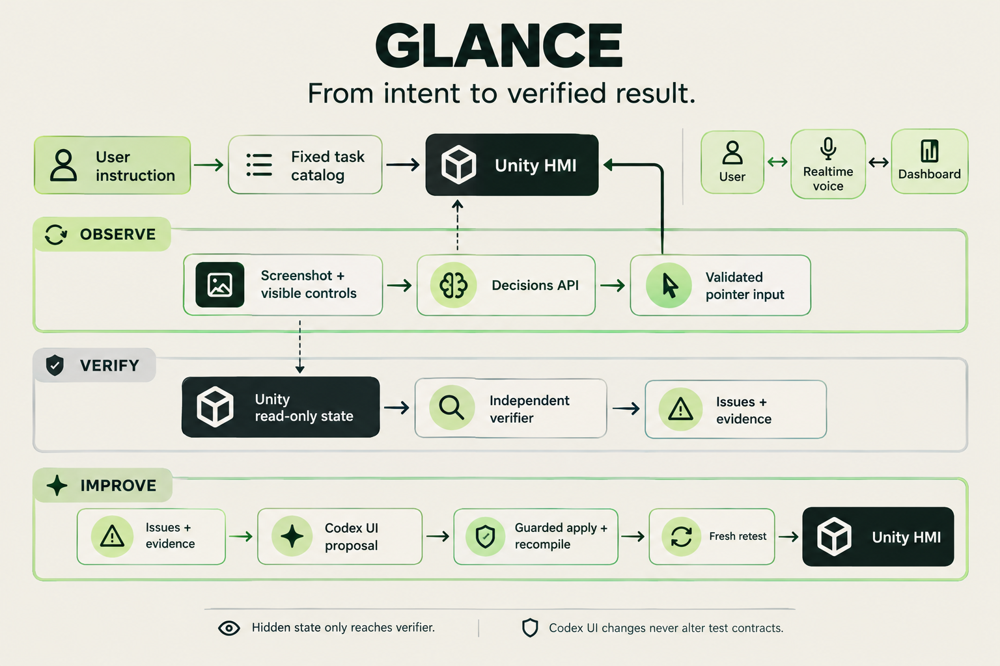

# Glance

AI-assisted inspection and improvement of automotive touchscreen prototypes, built for the DevDay Exchange Community Hackathon in London on 1 November 2026.

The working journey is **test an HMI → measure interaction friction → let Codex revise the UI → run a fresh test and climate regression → compare results**. OpenAI Decisions API selects actions from the currently visible controls; independent code executes inputs and verifies outcomes. This is an assisted, instrumented walkthrough, not a measurement of human distraction or regulatory compliance.

## Architecture



Decisions selects visible controls, real pointer inputs operate Unity, and an independent verifier checks outcomes. Codex proposes guarded radio UI changes followed by compilation and fresh retests.

## Working core

- OpenAI Decisions API (`gpt-6-luna`) selects visible HMI controls from screenshots and a neutral control inventory.
- A real Unity Input System virtual mouse executes clicks/drags. An independent state checker verifies radio selection and driver/passenger temperatures.
- Radio baseline: **3/3 successful, median 5 inputs**. Codex-revised UI: **4/4 successful, median 1 input**. Corrected screen counts include the final confirmation: **6 → 2**.
- Climate regression passed after the UI change: driver **21°C**, passenger unchanged at **22°C**.
- Codex generated a source proposal from the measured findings; review confirmed only UI presentation methods changed before applying and retesting it.
- The local dashboard runs tests, replays genuine screenshots with input markers, displays measured results, and exposes the actual Codex diff. Failed exploratory runs remain visible.

[59-second demo replay](docs/build/glance-demo.mp4) · [Measured evidence](docs/build/evidence/index.json) · [Codex diff](docs/build/redesign/ui.patch) · [Validation notes](docs/build/VALIDATION.md)

The demo is a captioned replay assembled from genuine API-run screenshots, not a live screen recording. This is a small synthetic Unity HMI, not an arbitrary-interface testing service or a validated human-distraction study.

## Run Glance

Requires Unity **6000.6.3f1**, Unity CLI **1.0.0-beta.15**, Node **24+** (verified with 26.0.0), and an OpenAI project with Decisions access. No npm dependencies are required.

1. Open `unity-hmi/` in Unity Hub; resolve its pinned packages.
2. Open `Assets/Scenes/Main.unity` and press Play. Keep this Editor running and avoid manual input during automation.
3. For live tests, put your own `OPENAI_API_KEY` in an ignored `.env.local` file, following `.env.example`. Never commit the key.
4. From the repository root, run `npm start` and open **http://127.0.0.1:3210**.
For an explicit offline demo, use `npm run replay`. It needs neither an API key nor a running Unity Editor, loads only archived evidence, and disables live execution.

5. Choose a supported instruction or task from the dashboard. Use **Load fresh HMI** for the nested-radio demo baseline, then the complete Codex cycle to evaluate, propose a guarded UI revision, compile and retest. Do not interact manually while automation owns Unity.

The dashboard includes voice conversation, task/result/category/revision filters, evidence-derived usability/functionality/infrastructure findings and linked Codex source changes. Twenty task contracts cover the controls instantiated in this scene; four enum-only body controls are explicitly unavailable. Gear tasks verify visible UI selection, not vehicle physics.

The checked-in UI is the tested revised version. Baseline screenshots, source snapshots and results are retained under `docs/build/evidence/`; the baseline source is also `docs/build/redesign/before.cs`. To repeat baseline collection, stop Play, restore that source to the single UI file, refresh/recompile, restart Main, and run `npm run test:radio`. This changes the local checkout; restore the revised UI afterward. Version hashes prevent labelling the revised UI as a baseline.

`npm run redesign` generates an isolated Codex source proposal from `findings.json` and the current Glance UI. This sends those two inputs to OpenAI Codex; use it only when you authorize that transfer. Review its retained `before.cs`/`after.cs`, then apply with `node runner/apply-revision.ts <redesign-run-id>`. The apply command rejects stale parents and changes outside `Show`/`Menu`. Refresh/recompile Unity and run fresh tests afterward. The CLI uses a structured source response because its tool host was unavailable during this build. The dashboard complete-cycle workflow automates guarded application, compilation and fresh retests with rollback; see [cycle details](docs/build/CYCLE.md).

Runs are serialized and bounded: 25 UI inputs, 40 Decisions calls, five minutes, and 200,000 reported tokens per run. These are local execution limits, not a guaranteed dollar cap; configure an appropriate Platform budget. API errors are retained as failures. Credentials stay in the coordinator and are stripped from Unity/Codex child-process environments. Local raw runs are ignored; `npm run export:evidence` exports screenshots/results and redacted traces.

## Repository layout

```text
unity-hmi/       Isolated Unity project: Assets, Packages and ProjectSettings
scripts/         Glance tooling and end-to-end verification
docs/unity-hmi/  Setup notes, pointer-driver usage and verification evidence
BUILD-BRIEF.md   Product scope and solo build plan
```

The Unity project is part of this repository, not a separate nested Git repository. Its generated Library, Temp, Logs, UserSettings and build folders are ignored.

Original verification traces remain local. Published `trace.public.json` copies replace absolute checkout paths with `<GLANCE_ROOT>`; screenshots and measured results are retained.

## Run the Unity sample

Verified with Unity **6000.6.3f1 arm64** on macOS, Unity CLI **1.0.0-beta.15**, and Pipeline package **0.9.1-exp.1**. The template specifies Unity 6000.3 or later; other Editor versions and platforms have not been verified here.

1. Clone this repository and install the required Unity Editor through Unity Hub.
2. Open `unity-hmi/` in the Editor. Allow Unity to resolve packages and rebuild its local Library.
3. Open `Assets/Scenes/Main.unity` and press Play. Use the bottom bar to switch screens.

With Unity CLI installed, run from the repository root:

```sh
unity open "$PWD/unity-hmi" --wait
```

No API key is needed for the current Unity sample or pointer check. No secrets belong in version control. These sample-only steps do not launch the Decisions runner; use the Glance instructions above.

## Verify pointer input

With the isolated project playing Main, run in another terminal:

```sh
python3 scripts/verify_unity_pointer.py
```

Requires Python 3 and Unity CLI on PATH; no third-party Python dependencies. The check uses only mouse events to navigate and change temperature; it reads widget geometry and application state for verification. Each invocation saves screenshots, trace and results under a timestamped `docs/unity-hmi/evidence/pointer/` directory. Avoid simultaneous manual input during a test.

See [pointer automation](docs/unity-hmi/POINTER-AUTOMATION.md), [Unity setup](docs/unity-hmi/SETUP.md), and the [build brief](BUILD-BRIEF.md) for details and remaining limitations. This verifies the local Editor input layer, not a live Decisions-powered agent or a Player/Web build.

## Existing work and credits

Unity supplies **Industry HMI Template 1.0.4**, including vehicle/cabin/traffic assets, scenes and template scripts. The download was verified against the catalog digest. Original notices are preserved in [TEMPLATE-LICENSE.md](unity-hmi/TEMPLATE-LICENSE.md), [TEMPLATE-README.md](unity-hmi/TEMPLATE-README.md), and [third-party notices](unity-hmi/TEMPLATE-ThirdPartyNotice.txt). The Unity Companion License and bundled third-party licences continue to apply; this repository does not relicense those materials.

Glance additions made during the hackathon include the synthetic radio UI, Decisions runner, locked task/state adapter, pointer automation, deterministic scoring, local dashboard, Codex UI revision, E2E verification, evidence and planning. Codex helped diagnose input focus/device routing, implement the pointer driver, and verify UI navigation and climate adjustment. GPT Image 2.5 Flare supplied generated artwork, and OpenAI Realtime supplies the dashboard voice agent. Existing template assets and all generated/third-party credits remain separate from Glance code.

## Latest acceptance and recording

The full-HMI pass and affected targeted retests provide a passing evaluation for each of the 20 available task contracts. This is not a single clean 20/20 suite on the final revision. All failed probes are retained in the 66 exported runs; unavailable scene controls are excluded from the active catalog. Final fan, music-pause and A/C-off real-input retests passed. See [validation](docs/build/VALIDATION.md) and [manual recording steps](docs/build/RECORDING-STEPS.md).

The automatic Codex patch scope is the Glance radio presentation methods. Native HMI controls can be evaluated, but arbitrary native-source fixes are not automatically applied. Voice is a real API integration; venue microphone quality depends on the recording environment.
